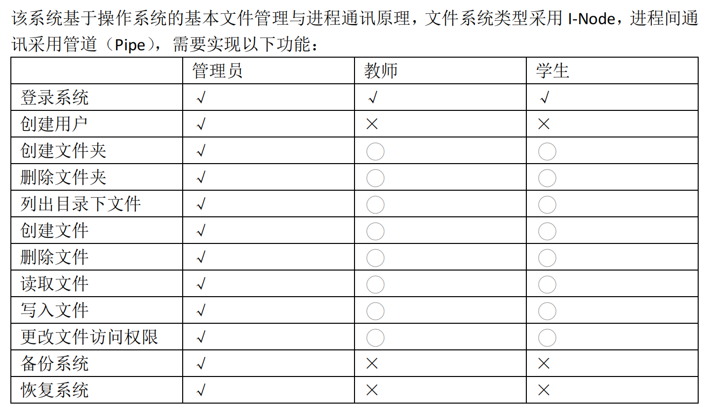
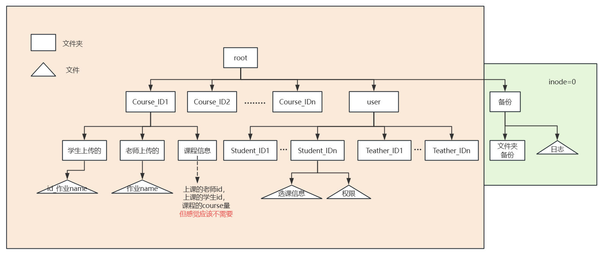
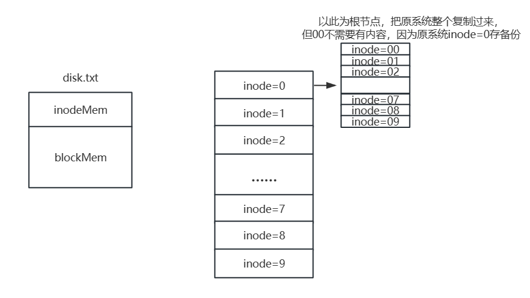
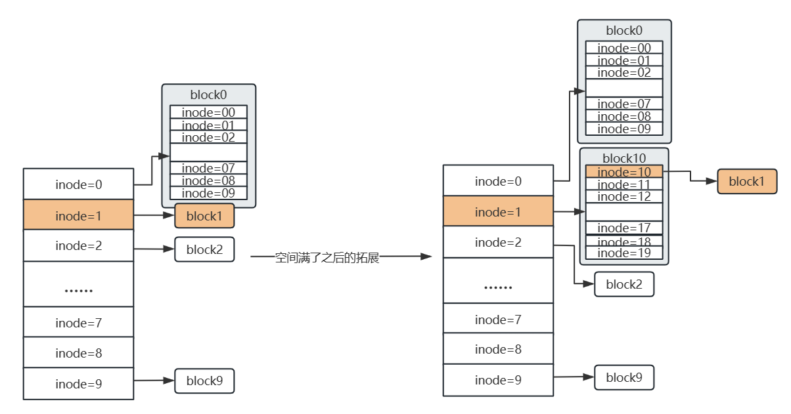

# OS-Student-Grade-Management-System
基于linux的C++编程实现的OS大作业：学生成绩管理系统

## **0 Assumption**
1. 暂时假设作业是字符串流，而非文件。
2. 一门课一个老师

## **1 Overview**
### **1.1 思路总览**
    系统构成=网络通信+登录等数据库操作+文件系统操作+备份与恢复（快照）
- **网络通信**：自定义协议实现本机多终端通信（实现使用socket）
- **数据库**：本项目仅将用户信息(id,account,name)和课程信息(id,name,credit)放入数据库中。数据库内数据不存在修改（备份恢复与注册除外）。
- **文件系统**：
  
  - 用一个txt文件模拟磁盘，使用inode做index管理。（具体见1.3）
  - 内置函数:createDir，deleteDir，ls，createFile，deleteFile，readFile，writeFile，changePrivilege。
  - 权限设置：权限设置是针对文件来设置的。功能函数均可访问，但访问后可能会有权限的阻挡，返回不可访问。（对于还没有文件的操作也是一样，要先输入路径，因此判断该路径下用户有没有权限做创建和查看的任务。）
  - 功能函数：功能函数相当于对内置函数的包装。例如：创建课程（创建文件夹），删除课程（删除文件夹），查看当前所选全部课程（ls），写作业（创建文件+写文件），查看作业（读文件），删除上传的文件（删除文件）......
  
- **备份与恢复**：
  - 磁盘上的文件：暂时用copy的方式备份。
  - 数据库的更改：以日志的方式做记录。
  
### **1.2 代码架构**
- **服务器端文件**<br/>

  T.cpp: 服务器端代码<br/>
  
- **用户端文件**<br/>

  U.cpp: 用户端代码<br/>
  
- **头文件与其cpp文件**<br/>
- 
  QUERY.h QUERY.cpp: 数据库查询相关的代码<br/>
  
  CODES.h CODES.cpp: 网络包裹解码以及操作码定义<br/>
  
  PRIVILEDGE.h PRIVILEDGE.cpp: 用户显示层功能以及用户的初始化<br/>
  
  PAGE_CHANGE.h PAGE_CHANGE.cpp: 用户显示层页面切换相关的代码<br/>
  
  DATAS.h: 系统命令相关的代码<br/>
  
  HOMEWORK.h HOMEWORK.cpp: 作业操作相关的代码<br/>
  
  Admin_method.h Admin_method.cpp: 管理员操作相关的代码<br/>

### **1.3 File System**
由于只考虑字符串的读写来模拟文件读写，所以客户端是不需要文件夹做数据记录的，因此只需要考虑终端的文件结构。
- **File Structure**
  
- **txt模拟磁盘**
  
- **MemExpansion**  
  当整个结构分配的系统空间不足的时候，从上向下，从外层到里层，找到最低级inodeLevel（inode属性inodeLevel：该inode连接的是几级结构）的inode,将对应的数据block的位置改为一个DirBlock，然后把该数据block置于改成目录的首位。
  
- **FileExpansion**  
  当文件大小大于1blcok时，需要fileExpansion。  
  暂时还没细想，实现过程书中有，目前推测就是在相关的block间像Dirblock那样加指针。

### **1.4 Process Communication**
- **远程访问**
  程序使用socket进行网络编程，实现用户的远程访问。
  本程序使用两个终端来模拟服务器端和用户端，使用UDP协议以及本机IP进行通信。
- **多用户访问**
  当用户端程序启动时，会向服务器请求一个地址，该地址是本次程序执行过程中，用户端的唯一标识。这个地址的取值是10000-19999，终端的地址是10000，并且整个服务器最多允许容纳9999个用户同时登录。标记用户地址是为了在本机监听的时候能够以该地址区分不同的身份。
- **通信协议**
  在用户收发包裹的时候，由于所有的用户都在本机端口监听，难免会出现接收错误的情况。为此，本程序设计了一个协议来解决这一问题。
  该协议由四部分组成：
  通信的包裹需要加上一串额外的信息， **操作码（1位）+ 目的地（5位）+ 发出地（5位）+ 包裹信息**
- **包裹处理**
  考虑到当用户很多的时候，包裹正确发送的几率会变得很小，本程序对于该协议做出了一些更改：
  错误的包裹有以下两种情况：1.目的地错误 2.操作码错误
  对于错误接收的包裹，接收方应当进行以下操作：<br/>
  
  **1.立刻将包裹传入数据流中**<br/>
  
  **2.等待1秒（解释见下文）** <br/>
  
  **3.返回重新监听**         <br/>
  
  第二步中的1s的等待是很有必要的，因为当用户很多的时候，很多个端口同时监听，发生错误的频率会很高，等待1秒是为了让发生错误的端口退出对于包裹的竞争。
  理想情况下，使用等待的方式，用户在1s内一定能收到想要的包裹。
  
  首先考虑将用户端的操作分为两类：1.需要用户信息的精确操作 2.不需要用户信息的粗略操作
  具体来说就是用户登录前的操作，是不需要涉及到用户个人信息的，所以是不需要用户信息的粗略操作。
  并且登录前终端返回的包裹不会有关于用户的内容，所以操作基本上都是由操作码完成的。
  用户登录后的操作，基本上100%都和用户个人身份等信息挂钩，所以是需要用户信息的精确操作。

  其次，本程序本质上不是一个多对多的通信，是一个多对一的通信，只有一个服务器终端接收不同用户的包裹。

  所以本程序使用了两种方案来辨别包裹是否是正确的：<br/>

  **1. 粗识别：辨别操作码和目的地**<br/>
  
  **2. 精识别：辨别操作码，目的地和发出地**<br/>

  对于粗识别，其服务于登录前的粗略操作，设想一百个用户同时登录的话，服务器端发出的登录确认的回馈是不需要区分目的地的，因为所有的用户端需要的只是那个操作码。这样一来，服务器只要接收到一个登录请求，不需要考虑发出地，就可以返回，节省了一个等待时间
  对于精识别，其服务于登陆后的精细操作，当用户登录成功后，终端会调用**thread库创建一个子线程**来点对点处理用户的包裹。这里用户的操作都包含了个人信息，不同用户同时进行相同操作时会发生错误，所以不能单纯考虑目的地。


## 2 Preparation
### Prepare MySQL
* [Install MySQL in Ubuntu](https://blog.csdn.net/fanrongwoaini/article/details/107518693)
* Create Database OS
```sql
create Database OS;
use OS;
```
* Create 2 tables: course、users
```sql
create TABLE course (
ID varchar(30) NOT NULL,
Course_name varchar(30),
Credit INT,
PRIMARY KEY(ID)) ;

create TABLE users(
ID varchar(30) NOT NULL,
Name  varchar(30),
Password  varchar(30),
Identity INT NOT NULL,
 PRIMARY KEY(ID));
```
* Insect course
```sql
insert into course values('CS101','Computer Science',2);
insert into course values('CS201','Data Structure',4);
insert into course values('CS505','C++ Programming',3);
insert into course values('CS809','Python',2);
insert into course values('B0103','Organic Chemistry',3);
insert into course values('B0511','Chemical Experiment',2);
insert into course values('01109','College Physics',4);
insert into course values('01201','Quantum Mechanics',4);
insert into course values('LA101','Chinese Language',2);
insert into course values('LA255','English Writing',2);
```
* Insect users:1:学生；2:老师；3：管理员;"200000000000"为root
```sql
insert into users values('202164700141','lwj','1',1);
insert into users values('202164700325','lyy','2',2);
insert into users values('202164700326','qqx','3',3);
insert into users values('200000000000','','123456',)
```
* 新增服务器用户，用于连接服务器
```sql
CREATE USER 'Manager'@'localhost' IDENTIFIED BY '123456';
GRANT ALL PRIVILEGES ON OS.* TO 'Manager'@'localhost';
FLUSH PRIVILEGES;
```
* TDB.cpp is used to check connection between mysql and Program;
```bash
g++ -o Compile/DBconnectTest TDB.cpp QUERY.cpp -I/usr/include/mysql -L/usr/lib/x86_64-linux-gnu -lmysqlclient

Compile/DBconnectTest
```

## Code
* Terminal:T.cpp ;  Client:U.cpp
* "mysql_config"查看LIB依赖:-I/usr/include/mysql -L/usr/lib/x86_64-linux-gnu -lmysqlclient
* compile and run
```bash
bash T.sh
bash U.sh
bash FS.sh
```
* Compile文件夹存储编译后的程序