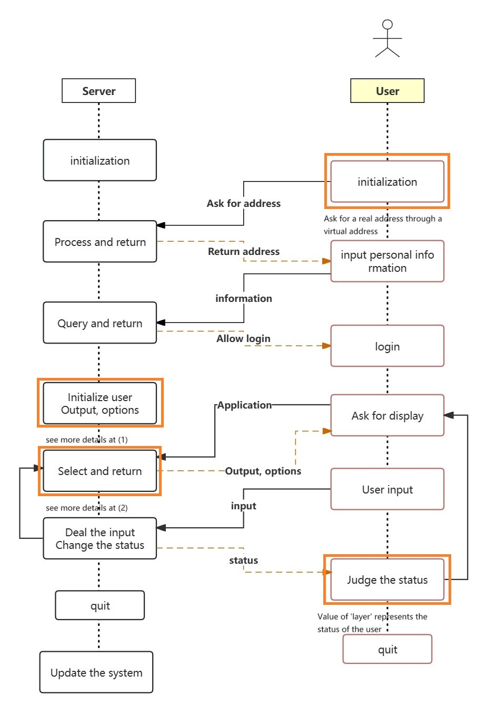
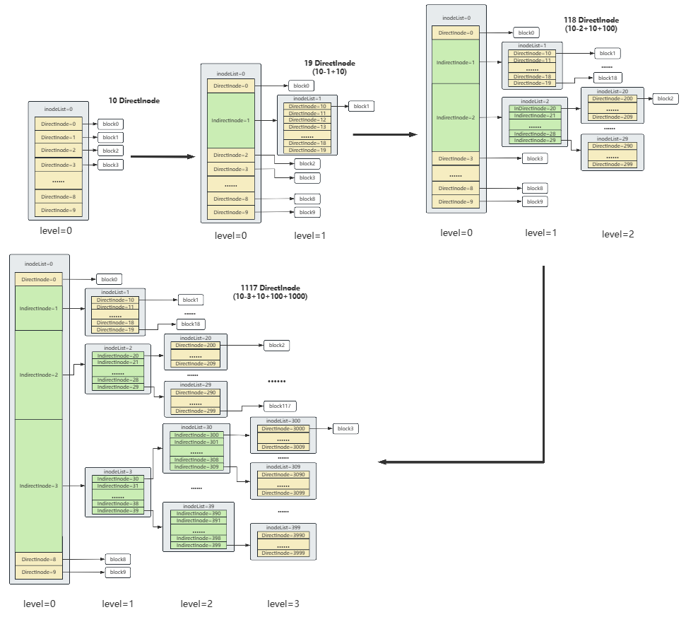
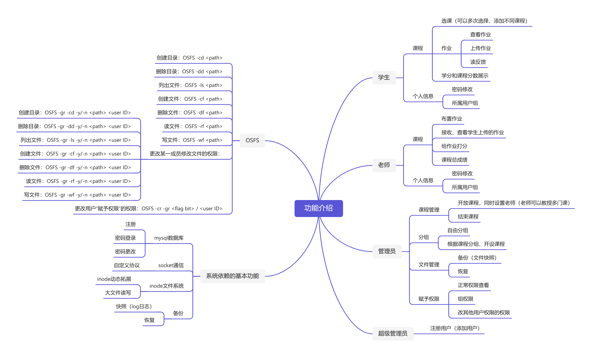
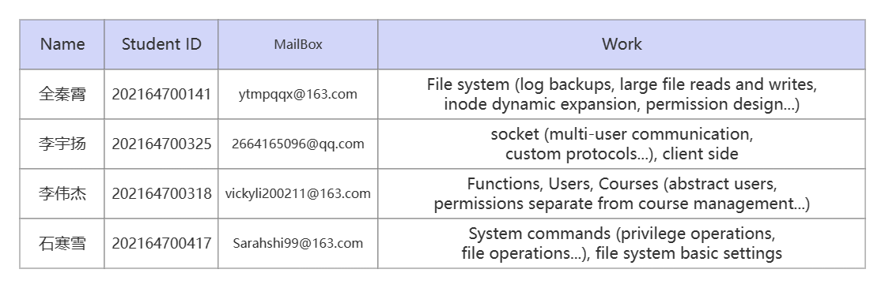

# LSQL: OS-Student-Grade-Management-System
- 基于linux的C++编程实现的OS大作业：学生成绩管理系统  
- Project for 2023fall OS Course

## **0 Assumption**
- 暂时假设作业是字符串流，而非文件
- 课程与老师：多对一
- 本机多端口通信

## **1 Overview**
### **1.1 思路总览**
    系统构成=网络通信+登录等数据库操作+文件系统操作+系统快照与恢复+权限限制
- **网络通信**：自定义协议实现本机多终端通信（实现使用socket）
- **数据库**：本项目仅将用户信息(id,account,name)和课程信息(id,name,credit)放入数据库中。数据库内数据不存在修改（备份恢复与注册除外）。
- **文件系统**：
  - 用一个txt文件模拟磁盘，使用inode做index管理。
  - 文件系统接口:createDir,deleteDir,ls,createFile,deleteFile,readFile,writeFile,changePermission,startCopy,recovery...
  - 权限设置：基础权限针对STA三大类，内置于文件系统中；特殊权限可通过个人权限设置或组权限设置，存放于用户个人信息中。
  
- **备份与恢复**：
  - 增改式日志。

- **系统呈现**：
  - **学生管理系统**：调用文件系统接口，基于socket通信实现。
  - 系统提供**系统命令**操作。
### **1.2 Communication Structure**
  


### **1.3 Process Communication**
- **远程访问**
  程序使用socket进行网络编程，实现用户的远程访问。
  本程序使用两个终端来模拟服务器端和用户端，使用UDP协议以及本机IP进行通信。
- **多用户访问**
  当用户端程序启动时，会向服务器请求一个地址，该地址是本次程序执行过程中，用户端的唯一标识。这个地址的取值是10000-19999，终端的地址是10000，并且整个服务器最多允许容纳9999个用户同时登录。标记用户地址是为了在本机监听的时候能够以该地址区分不同的身份。
- **通信协议**
  在用户收发包裹的时候，由于所有的用户都在本机端口监听，难免会出现接收错误的情况。为此，本程序设计了一个协议来解决这一问题。
  该协议由四部分组成：
  通信的包裹需要加上一串额外的信息， **操作码（1位）+ 目的地（5位）+ 发出地（5位）+ 包裹信息**
- **包裹处理**
  考虑到当用户很多的时候，包裹正确发送的几率会变得很小，本程序对于该协议做出了一些更改：
  错误的包裹有以下两种情况：1.目的地错误 2.操作码错误
  对于错误接收的包裹，接收方应当进行以下操作：<br/>
  
  **1.立刻将包裹传入数据流中**<br/>
  
  **2.等待1秒（解释见下文）** <br/>
  
  **3.返回重新监听**         <br/>
  
  本系统使用了两种方案来辨别包裹是否是正确的：<br/>

  **1. 粗识别：辨别操作码和目的地**<br/>
  
  **2. 精识别：辨别操作码，目的地和发出地**<br/>

### **1.4 File System**
由于只考虑字符串的读写来模拟文件读写，所以客户端是不需要文件夹做数据记录的，因此只需要考虑终端的文件结构。
- **File System**
  

- **Project File Structure**
  
- **FileExpansion**  
  当文件大小大于1blcok时，需要fileExpansion。  
  通过尾部指针的方式，来实现。

### **1.5 System Function**
  

## 2 Preparation
### Prepare MySQL
* [Install MySQL in Ubuntu](https://blog.csdn.net/fanrongwoaini/article/details/107518693)
* "mysql_config"查看LIB依赖:-I/usr/include/mysql -L/usr/lib/x86_64-linux-gnu -lmysqlclient
* Create Database OS
```sql
create Database OS;
use OS;
```
* Create 2 tables: course、users
```sql
create TABLE course (
ID varchar(30) NOT NULL,
Course_name varchar(30),
Credit INT,
PRIMARY KEY(ID)) ;

create TABLE users(
ID varchar(30) NOT NULL,
Name  varchar(30),
Password  varchar(30),
Identity INT NOT NULL,
 PRIMARY KEY(ID));
```
* Insect course
```sql
insert into course values('CS101','Computer Science',2);
insert into course values('CS201','Data Structure',4);
insert into course values('CS505','C++ Programming',3);
insert into course values('CS809','Python',2);
insert into course values('B0103','Organic Chemistry',3);
insert into course values('B0511','Chemical Experiment',2);
insert into course values('01109','College Physics',4);
insert into course values('01201','Quantum Mechanics',4);
insert into course values('LA101','Chinese Language',2);
insert into course values('LA255','English Writing',2);
```
* Insect users:ID为6位;5个学生，3个老师
1:学生；2:老师；3：管理员;"200000000000"为root
```sql
insert into users values('700141','lwj','1',1);
insert into users values('700302','sds','2',2);
insert into users values('700313','qqx','3',3);
insert into users values('200000','root','123456',3);
```
* 新增服务器用户，用于连接服务器
```sql
CREATE USER 'Manager'@'localhost' IDENTIFIED BY '123456';
GRANT ALL PRIVILEGES ON OS.* TO 'Manager'@'localhost';
FLUSH PRIVILEGES;
```
* TDB.cpp is used to check connection between mysql and Program;
```bash
g++ -o Compile/DBconnectTest TDB.cpp QUERY.cpp -I/usr/include/mysql -L/usr/lib/x86_64-linux-gnu -lmysqlclient

Compile/DBconnectTest
```
### prepare FileSystem
```bash
bash UACT.sh
```
## 3 Compile and Run
```bash
# 编译运行服务器端
bash T.sh
# 编译运行客户端
bash U.sh
```
## 4 Document Architecture
<!-- * Terminal:T.cpp ;  Client:U.cpp ; FileSystem: inode.cpp,txt.cpp -->
* Compile文件夹存储编译后的程序
* disk_group_init.txt为初始化好的文件系统。
### 代码
- **服务器端文件**<br/>

  T.cpp: 服务器端代码<br/>
  
- **用户端文件**<br/>

  U.cpp: 用户端代码<br/>
  
- **头文件与其cpp文件**<br/>
- 
  QUERY.h QUERY.cpp: 数据库查询相关的代码<br/>
  
  CODES.h CODES.cpp: 网络包裹解码以及操作码定义<br/>
  
  PRIVILEDGE.h PRIVILEDGE.cpp: 用户显示层功能以及用户的初始化<br/>
  
  PAGE_CHANGE.h PAGE_CHANGE.cpp: 用户显示层页面切换相关的代码<br/>
  
  DATAS.h: 系统命令相关的代码<br/>
  
  HOMEWORK.h HOMEWORK.cpp: 作业操作相关的代码<br/>
  
  Admin_method.h Admin_method.cpp: 管理员操作相关的代码<br/>

  inode.cpp inode.h txt.cpp txt.h: 文件系统代码

  USER.cpp USER.h：用户类代码

  COURSE.cpp COURSE.h: 课程类代码

## 5 More Detail
见Project Report & PPT

## 6 Contact Us
 
